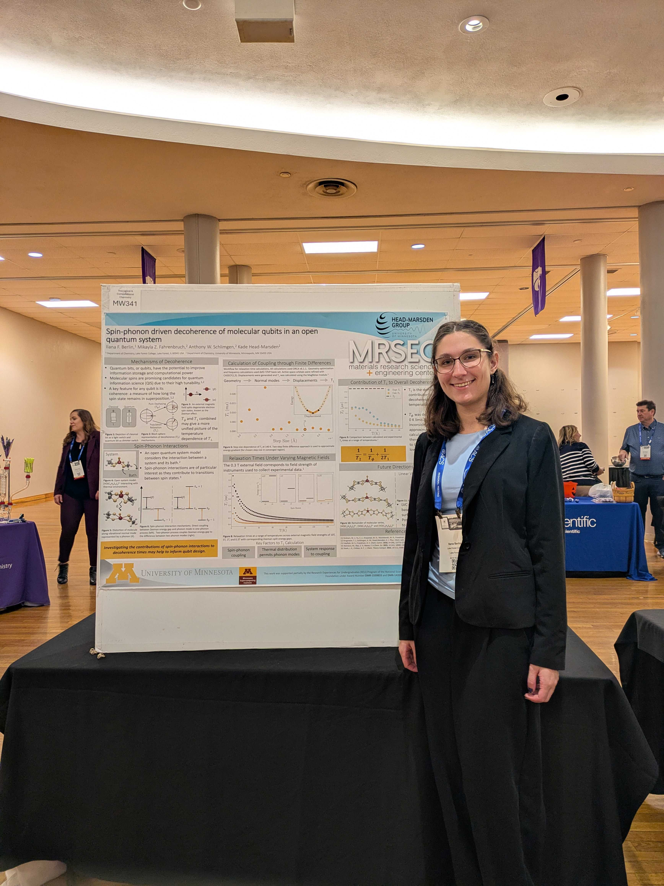

Ilana Berlin, mentored by graduate student Mikayla Fahrenbruch, presented the results from her summer MRSEC research program at the Midwest 
Regional ACS Meeting at Kansas State University. Excellent job Ilana!

{: .text-justify}
